# 🕹️ ARCADE_SPEC.md — 3-Game Arcade Triad Architectural Master Specification
**Project:** Autonomous 36-Agent Universal Game & Software Studio  
**Author:** Agent 26 — Master Tech-Stack & Architecture Planner (`tech_stack_architect_planner`)  
**Supervising Authority:** Agent 4 — CEO & Lead Orchestrator  
**Status:** Approved for Full Autonomous Parallel Production (Zero-Conflict Contract)  
**Target Performance:** 60–120 FPS Continuous, 0 External Dependencies, 100% Procedural Web Audio & Canvas 2D / 2.5D  

---

## 🏛️ 1. Executive Triad Architecture & Production Matrix

The **Arcade Triad** is engineered as a three-genre showcase demonstrating the full capabilities of the autonomous 36-agent studio. Each game runs directly in any modern browser without external assets, frameworks, or network dependencies.

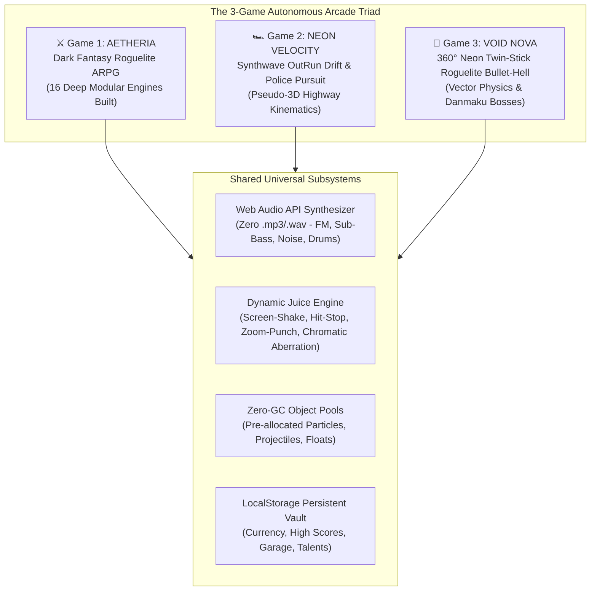

### Triad Production Status Matrix

| Game № | Title & Genre | Engine Style | Key Mechanics | Production Target File | Global Namespace |
| :--- | :--- | :--- | :--- | :--- | :--- |
| **Game 1** | **Aetheria: Kölgələrin Səltənəti**<br/>*Dark Fantasy Roguelite ARPG* | Top-Down 2.5D Roguelite | 4 Hot-Swap Weapons, Pet Companion, Diablo Loot Beams, 3-Branch Talent Tree, Endless Arena, 3-Phase Bosses | `index.html` + 16 `src/*.js` modules | `window.GameCore`, `window.GameRelics`, `window.GameTalents` |
| **Game 2** | **Neon Velocity**<br/>*Synthwave OutRun Drift & Pursuit* | Pseudo-3D Curved Highway | Elevation & Multi-Curves, 3 Selectable Tuners, Deep Slip Drift, Heat 1–5 Police Pursuit, Ramming Cruisers, FM Synthwave Audio, Upgrade Garage | `racer.html` (Standalone zero-dependency production bundle) | `window.NeonVelocity` |
| **Game 3** | **Void Nova**<br/>*360° Neon Twin-Stick Bullet-Hell* | 360° Vector Space Arena | Dual Thruster Inertia, 4 Hot-Swappable Weapons, Boids Flocks, Fibonacci Danmaku Boss, Roguelite Boon Drafting, Dynamic BPM Tempo Techno Synth | `shooter.html` (Standalone zero-dependency production bundle) | `window.VoidNova` |

---

## 🏎️ 2. GAME 2: "NEON VELOCITY: Synthwave OutRun Drift & Police Pursuit"

### 2.1 Pseudo-3D Road Mathematics & Camera Projection

The road engine uses the classic scanline pseudo-3D algorithm with continuous vertical elevation (hills) and 3D multi-curve deflection.

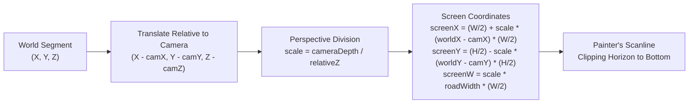

#### Mathematical Projection Formulas

Given:
- Screen dimensions: $W$ (width), $H$ (height)
- Field of view depth: $\text{cameraDepth} = \frac{1}{\tan\left(\frac{\text{FOV}}{2}\right)}$ (typically $0.84$)
- Player / Camera position: $\vec{C} = (C_x, C_y, C_z)$ where $C_y = \text{playerSegment.y} + \text{cameraHeight}$
- Segment point: $P_{\text{world}} = (X, Y, Z)$

Relative coordinate transformation:
$$Z_{\text{rel}} = P_z - C_z$$
$$X_{\text{rel}} = P_x - C_x$$
$$Y_{\text{rel}} = P_y - C_y$$

Perspective projection (for $Z_{\text{rel}} > 0$):
$$\text{scale} = \frac{\text{cameraDepth}}{Z_{\text{rel}}}$$
$$S_x = \text{round}\left(\frac{W}{2} + \text{scale} \cdot X_{\text{rel}} \cdot \frac{W}{2}\right)$$
$$S_y = \text{round}\left(\frac{H}{2} - \text{scale} \cdot Y_{\text{rel}} \cdot \frac{H}{2}\right)$$
$$S_w = \text{round}\left(\text{scale} \cdot \text{roadWidth} \cdot \frac{W}{2}\right)$$

#### Continuous Road Generation Contract

A road consists of an array of $N$ segments ($N = 2000$, segment length $L = 200\text{m}$, total track length $400,000\text{m}$).

```javascript
// Segment Data Contract
const RoadSegment = {
  index: 0,
  p1: { world: { x: 0, y: 0, z: 0 }, screen: { x: 0, y: 0, w: 0, scale: 0 } },
  p2: { world: { x: 0, y: 0, z: 0 }, screen: { x: 0, y: 0, w: 0, scale: 0 } },
  curve: 0.0,       // dX per segment (-4.0 to +4.0)
  elevation: 0.0,   // sinusoidal hill height (-1500 to +3000)
  clip: 0.0,        // dynamic bottom-up scanline occluder
  color: {
    road: '#1a0033',      // dark synthwave tarmac
    grass: '#050014',     // neon void grid ground
    rumble: '#ff007f',    // neon magenta rumble strip
    lane: '#00f5ff'       // cyan dashed dividing line
  },
  sprites: [],      // scenery roadside billboards, neon palm trees, grid arches
  cars: []          // traffic cars and police pursuit cruisers
};
```

#### Road Topography Generation Algorithm

The track is procedurally generated with 6 distinct sections:
1. **Neon Strip (Straight):** 200 segments, curve = 0, elevation = 0.
2. **Cyber Ridge (Gentle S-Curves & Rolling Hills):** 300 segments, $\text{curve} = \sin(i \cdot 0.03) \cdot 2.5$, $\text{elevation} = \sin(i \cdot 0.04) \cdot 1800$.
3. **OutRun Canyon (Hairpin Drift Curves):** 250 segments, $\text{curve} = 3.8$, banking camber on rumble strips.
4. **Hyper-Grid Overpass (Steep Crest & Roller-coaster Dip):** 250 segments, $\text{elevation} = \sin(i \cdot 0.02) \cdot 3200$.
5. **Pursuit Alley (Multi-lane Highway with Heavy Traffic):** 400 segments, $\text{curve} = -2.0$, dual-lane divider lines.
6. **Synthwave Horizon (Terminal High-Speed Straightaway):** 600 segments leading to the Finish Line arch with dynamic sun scale.

---

### 2.2 Vehicle Dynamics, 3 Tuner Cars & Deep Drift Kinematics

#### Selectable Cars Specification

```javascript
const VEHICLE_ROSTER = {
  interceptor: {
    id: 'interceptor',
    name: 'V-800 INTERCEPTOR',
    tagline: 'Balanced Cyber-Enforcer with EMP Pulse',
    baseTopSpeed: 300,      // km/h
    acceleration: 1.15,     // m/s^2 multiplier
    handling: 0.88,         // steering response
    driftGrip: 0.78,        // lateral slide coefficient
    driftScoreMult: 1.5,
    armorMass: 1.4,         // ramming impact power
    nitroDuration: 3.5,     // seconds
    color: '#00f5ff',       // Neon Cyan
    accentColor: '#ffffff',
    special: 'EMP Shockwave: Nitro activation neutralizes nearby spike strips and disorients cop cruisers.'
  },
  cyber_drifter: {
    id: 'cyber_drifter',
    name: 'SHINOBI GT DRIFTER',
    tagline: 'High-Angle Drift Specialist with Fire Trails',
    baseTopSpeed: 320,
    acceleration: 1.25,
    handling: 0.72,         // lower grip = enters drift instantaneously
    driftGrip: 0.55,        // slick slide physics
    driftScoreMult: 3.0,    // maximum drift multiplier
    armorMass: 0.85,        // fragile chassis
    nitroDuration: 4.2,
    color: '#ff007f',       // Neon Magenta
    accentColor: '#ffe600',
    special: 'Neon Combustion: Drift angle > 45° ignites twin tire smoke into magenta fire, doubling credit accrual.'
  },
  phantom: {
    id: 'phantom',
    name: 'PHANTOM HYPER-XR',
    tagline: 'Experimental Stealth Aerotuner with Phase Shift',
    baseTopSpeed: 360,
    acceleration: 1.40,
    handling: 0.96,         // razor-sharp aerodynamic downforce
    driftGrip: 0.82,
    driftScoreMult: 2.0,
    armorMass: 1.05,
    nitroDuration: 5.0,
    color: '#9d00ff',       // Electric Violet
    accentColor: '#00f5ff',
    special: 'Phase Cloak: Maximum nitro triggers lightspeed phase cloak, allowing the car to phase right through road spikes.'
  }
};
```

#### Drift Kinematics & Physics State Machine

Drift is not a scripted animation; it is an integrated Newtonian lateral slip simulation.

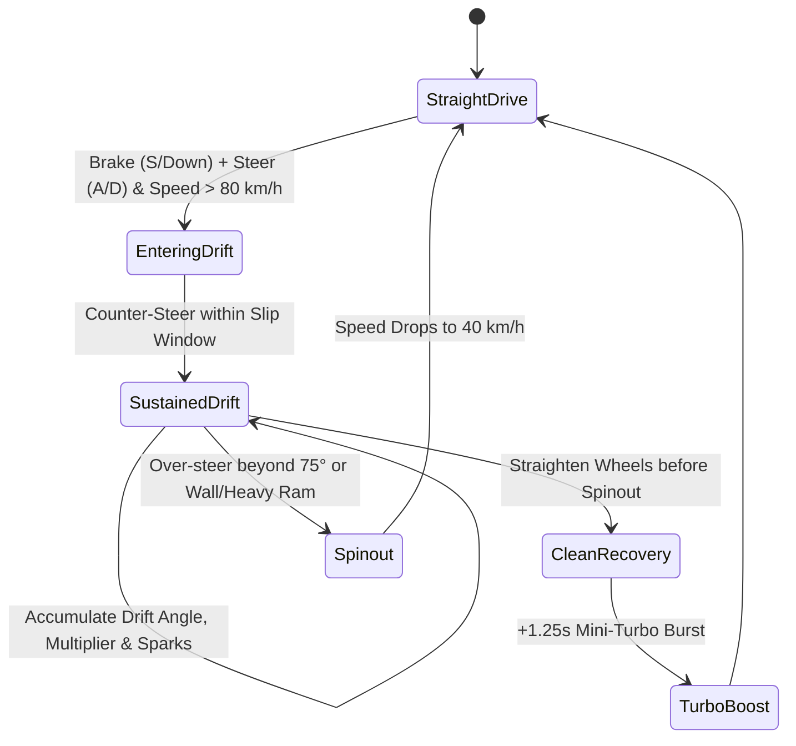

#### Drift Mathematics & Formulae

Let:
- Forward velocity: $V_f$ ($\text{m/s}$)
- Steering input: $u_{\text{steer}} \in [-1, 1]$
- Brake input: $u_{\text{brake}} \in [0, 1]$
- Drift state: $\text{isDrifting} \in \{\text{false}, \text{true}\}$
- Drift angle: $\theta_{\text{drift}}$ (radians)
- Slip coefficient: $\mu_{\text{slip}}$ (starts at $1.0$, drops to $0.58$ in drift)

1. **Trigger Condition:**
   $$\text{Speed} \ge 80\,\text{km/h} \quad \land \quad u_{\text{brake}} > 0.5 \quad \land \quad |u_{\text{steer}}| > 0.3 \implies \text{isDrifting} = \text{true}$$

2. **Angular Inertia & Counter-Steer Integration:**
   $$\frac{d\theta_{\text{drift}}}{dt} = \left(u_{\text{steer}} \cdot \omega_{\text{turn}} - \text{sign}(\theta_{\text{drift}}) \cdot k_{\text{align}}\right) \cdot \left(\frac{V_f}{V_{\max}}\right)$$
   Where $k_{\text{align}}$ is the self-aligning torque of the tires.

3. **Lateral Displacement:**
   $$X_{\text{player}} \leftarrow X_{\text{player}} + \left(u_{\text{steer}} \cdot \text{handling} \cdot \mu_{\text{slip}} + \sin(\theta_{\text{drift}}) \cdot \text{centrifugalForce}\right) \cdot dt$$

4. **Drift Score Calculation:**
   $$\text{DriftTicks} \leftarrow \text{DriftTicks} + 1$$
   $$\text{ScoreFrame} = |\sin(\theta_{\text{drift}})| \times \left(\frac{\text{Speed}}{100}\right) \times \text{Car.driftScoreMult} \times \text{DriftCombo}$$
   $$\text{DriftCombo} = 1.0 + \min\left(4.0, \frac{\text{ContinuousDriftTime}}{1.2}\right)$$

5. **Clean Exit Mini-Turbo:**
   If drift is sustained $> 1.5\text{s}$ and exited cleanly without collision, the car receives a **+20% speed burst** for $1.5\text{s}$ with dual blue backfire flame sprites!

---

### 2.3 Police Pursuit System (Heat Levels 1–5 & Ramming Mechanics)

The pursuit engine dynamically spawns highway patrol cruisers, tactical roadblocks, spike strips, armored SWAT Rhinos, and police gunships based on the player's Heat Level.

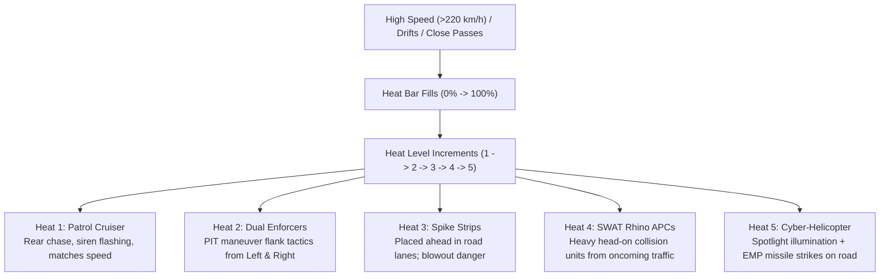

#### Heat Level Parameters

| Heat Level | Spawning Units | Tactics & Behaviors | Road Obstacles | Escape / Survival Reward |
| :---: | :--- | :--- | :--- | :--- |
| **1** | 1x Metro Patrol Cruiser | Follows $150\text{m}$ behind, accelerates to match player speed, sounds siren | None | +500 Credits |
| **2** | 2x Tactical Interceptors | Flanks left and right, executes PIT maneuver against player's rear quarter | Occasional traffic blockades | +1,200 Credits |
| **3** | 3x Tactical Interceptors | Aggressive ramming, forces player toward road shoulder | **Spike Strips** deployed on 1 or 2 lanes | +2,500 Credits |
| **4** | 2x Enforcers + 1x SWAT Rhino | Rhino charges head-on from oncoming lane at $200\text{km/h}$; massive kinetic mass | Armored roadblock barriers | +5,000 Credits |
| **5** | All above + Cyber-Helicopter | Helicopter flies overhead, tracks with glowing searchlight, fires timed EMP missiles | Roadblocks + Multi-lane spikes | +12,000 Credits (Pursuit Evaded) |

#### Ramming & Cruiser Takedown Mechanics (Burnout Style)

When the player's vehicle impacts an enemy cruiser:
1. **Kinetic Collision Calculation:**
   $$\vec{P}_{\text{impact}} = M_{\text{player}} \cdot \vec{V}_{\text{player}} - M_{\text{cruiser}} \cdot \vec{V}_{\text{cruiser}}$$
   If the player collides with the cruiser's flank while in **Nitro** or **Drift**, or if relative speed $\Delta V > 60\text{km/h}$:
   - **Cruiser TAKEDOWN!**
   - The cruiser enters spinout roll, flips with neon spark explosion and shattered glass particles.
   - Player receives:
     - Screen-shake magnitude: $18\text{px}$
     - Hit-stop: $120\text{ms}$ freeze-frame
     - +50% Nitro gauge replenishment
     - Dynamic onscreen banner: `"TAKEDOWN! +$1,500"`
2. **Spike Strip Interaction:**
   - If player crosses segment containing `spikeStrip` at $X_{\text{car}} \approx X_{\text{spike}}$:
     - Tires blown! Top speed capped to $80\text{km/h}$ for $4.0\text{s}$, sparks fly from bare rims.
     - *Counter-play:* Phantom phase shift, Interceptor EMP pulse, or swerving around spikes via drift.

---

### 2.4 Procedural Web Audio Synthwave Engine for Neon Velocity

Zero external MP3/WAV files. Built entirely on the HTML5 `AudioContext` with multi-node signal routing:

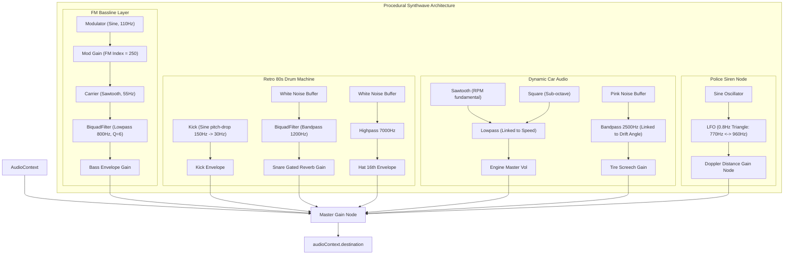

#### Audio Sequencer Pattern (124 BPM Synthwave in D Minor)

- Bassline 16-step sequence: `D1 - D1 - D1 - F1 - D1 - D1 - G1 - A1 - D1 - D1 - C2 - Bb1 - A1 - G1 - F1 - E1`
- Synth Leads: Polyphonic detuned saw waves playing retro chords: `Dm -> Bb -> C -> Am`
- Engine pitch algorithm:
  $$f_{\text{engine}} = f_{\text{idle}} + \left(\frac{\text{CurrentSpeed}}{\text{MaxSpeed}}\right) \cdot (f_{\text{redline}} - f_{\text{idle}})$$
  Where $f_{\text{idle}} = 65\text{Hz}$ and $f_{\text{redline}} = 480\text{Hz}$, modulated with a subtle $6\text{Hz}$ engine vibration vibrato.

---

### 2.5 Upgrade Garage & Persistence Architecture

The player earns **Neon Credits** via:
- Drift Distance ($100\text{m} = \$50 \times \text{Multiplier}$)
- Near Misses ($+\$200$ for brushing past traffic cars at $>200\text{km/h}$)
- Police Takedowns ($+\$1,500$ per cruiser, $+\$4,000$ per SWAT Rhino)
- Race Completion & Time Trial Bonus

```javascript
const GARAGE_UPGRADE_TREE = {
  topSpeed: {
    name: 'Twin Vortex Turbo',
    icon: '⚡',
    levels: [
      { cost: 0, boost: 0, desc: 'Stock Engine Setup' },
      { cost: 2500, boost: 15, desc: '+15 km/h Top Velocity' },
      { cost: 6000, boost: 30, desc: '+30 km/h Top Velocity' },
      { cost: 12000, boost: 45, desc: '+45 km/h Ceramic Impellers' },
      { cost: 25000, boost: 65, desc: '+65 km/h Plasma Hyper-Burn' }
    ]
  },
  nitro: {
    name: 'Liquid Nitrogen Injection',
    icon: '🔥',
    levels: [
      { cost: 0, boost: 1.0, desc: 'Standard 1x Tank' },
      { cost: 3000, boost: 1.4, desc: '+40% Duration & Fast Refill' },
      { cost: 7500, boost: 1.8, desc: '+80% Capacity with Dual Valves' },
      { cost: 15000, boost: 2.3, desc: '+130% Extended Afterburner' },
      { cost: 30000, boost: 3.0, desc: 'Triple Tank Infinite Overdrive' }
    ]
  },
  armor: {
    name: 'Reinforced Kinetic Chassis',
    icon: '🛡️',
    levels: [
      { cost: 0, boost: 1.0, desc: 'Standard Frame' },
      { cost: 2000, boost: 1.3, desc: '+30% Ramming Mass vs Cruisers' },
      { cost: 5000, boost: 1.7, desc: '+70% Kinetic Impact Deflection' },
      { cost: 10000, boost: 2.2, desc: 'Tire Sealant: Spikes slow by only 50%' },
      { cost: 22000, boost: 3.0, desc: 'Heavy Ram Ram-Bumper: Instantly explodes normal cruisers' }
    ]
  },
  handling: {
    name: 'Slick Drift Suspension & Tires',
    icon: '🛞',
    levels: [
      { cost: 0, boost: 1.0, desc: 'Factory Tires' },
      { cost: 2500, boost: 1.25, desc: '+25% Drift Angle Stability' },
      { cost: 6500, boost: 1.60, desc: '+60% Drift Score Generation' },
      { cost: 14000, boost: 2.10, desc: 'Quick Counter-Steer Recovery' },
      { cost: 28000, boost: 2.80, desc: 'Cyber-Grip: Clean drift exit mini-turbo doubled' }
    ]
  }
};
```

---

## 🚀 3. GAME 3: "VOID NOVA: 360° Neon Twin-Stick Roguelite Bullet-Hell"

### 3.1 360° Vector Starship & Dual-Thruster Physics

Void Nova runs on a continuous 2D toroidal/bounded space coordinate system ($3200 \times 3200\text{px}$ arena) with dynamic viewport tracking and dual-thruster Newtonian physics.

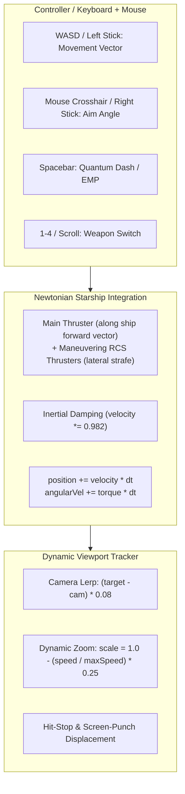

#### Starship State Variable Specification

```javascript
const StarshipState = {
  x: 1600,
  y: 1600,
  vx: 0,
  vy: 0,
  angle: -Math.PI / 2,     // facing upwards
  aimAngle: -Math.PI / 2,  // independent aim towards reticle
  angularVelocity: 0,
  mass: 1.0,
  linearThrust: 850,       // px / s^2
  strafeThrust: 450,       // lateral thruster px / s^2
  maxSpeed: 620,           // px / s
  drag: 0.982,             // inertial space friction
  hp: 100,
  maxHp: 100,
  shield: 50,
  maxShield: 50,
  shieldRechargeDelay: 4.0,// seconds without hit to recharge
  shieldTimer: 0,
  dashCooldown: 1.5,
  dashTimer: 0,
  dashDuration: 0.22,
  isDashing: false,
  activeWeaponIndex: 0,
  empBombs: 2,
  comboStreak: 0,
  comboTimer: 0,
  boons: []                // drafted roguelite perks
};
```

#### Newton-Euler Integration Equations

At each frame $\Delta t$:
$$\vec{F}_{\text{thrust}} = \vec{u}_{\text{move}} \cdot \text{linearThrust}$$
$$\vec{a} = \frac{\vec{F}_{\text{thrust}}}{\text{mass}}$$
$$\vec{v} \leftarrow (\vec{v} + \vec{a} \cdot \Delta t) \times (\text{drag})^{\Delta t \cdot 60}$$
$$\|\vec{v}\| \leftarrow \min(\|\vec{v}\|, \text{maxSpeed})$$
$$\vec{P}_{\text{ship}} \leftarrow \vec{P}_{\text{ship}} + \vec{v} \cdot \Delta t$$
$$\theta_{\text{aim}} = \text{atan2}(y_{\text{reticle}} - y_{\text{ship}}, x_{\text{reticle}} - x_{\text{ship}})$$

---

### 3.2 4 Hot-Swappable Weapons (Data Contracts & Projectile Mechanics)

Players can freely switch between 4 specialized neon weapons with keys `[1], [2], [3], [4]` or the mouse scroll wheel.

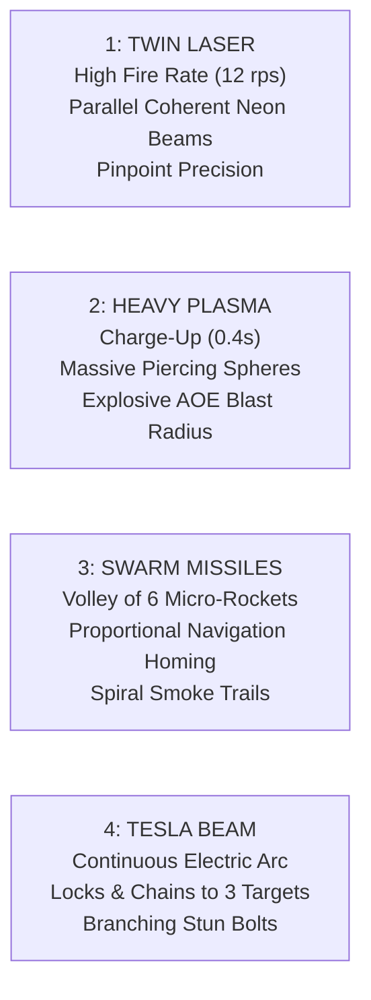

#### Weapon Data Contract

```javascript
const WEAPON_REGISTRY = [
  {
    id: 'twin_laser',
    slot: 1,
    name: 'VORTEX TWIN LASER',
    fireRate: 12,           // rounds per second
    cooldown: 1 / 12,
    timer: 0,
    damage: 18,
    speed: 1400,
    range: 1200,
    spread: 0.02,
    dualOffset: 14,         // distance between twin barrels (px)
    color: '#00f5ff',       // Cyan
    glow: 'rgba(0, 245, 255, 0.8)',
    soundType: 'laser_zap'
  },
  {
    id: 'heavy_plasma',
    slot: 2,
    name: 'MATTER ANNIHILATOR PLASMA',
    fireRate: 2.2,
    cooldown: 1 / 2.2,
    timer: 0,
    damage: 110,
    speed: 650,
    radius: 16,
    aoeRadius: 85,          // explosion radius on hit
    piercing: 3,            // passes through 3 smaller units
    recoilImpulse: 120,     // pushes starship backwards
    color: '#ff007f',       // Magenta
    glow: 'rgba(255, 0, 127, 0.8)',
    soundType: 'plasma_boom'
  },
  {
    id: 'swarm_missiles',
    slot: 3,
    name: 'HYDRA SEEKER PODS',
    fireRate: 1.8,          // bursts per second
    cooldown: 1 / 1.8,
    timer: 0,
    salvoCount: 6,          // 6 micro-missiles per shot
    damage: 28,             // per missile
    speed: 750,
    turnRate: 9.5,          // rad/s homing navigation
    seekingRadius: 650,
    smokeInterval: 0.02,
    color: '#ffaa00',       // Amber / Orange
    glow: 'rgba(255, 170, 0, 0.8)',
    soundType: 'missile_whoosh'
  },
  {
    id: 'tesla_beam',
    slot: 4,
    name: 'ZEUS RESONANCE ARC',
    fireRate: 60,           // continuous beam ticked every frame
    cooldown: 1 / 60,
    timer: 0,
    damagePerSec: 160,
    maxChainTargets: 3,
    maxRange: 340,
    chainJumpRadius: 220,
    branchSegments: 6,      // midpoint displacement jagged lightning
    color: '#00ffaa',       // Emerald Neon
    glow: 'rgba(0, 255, 170, 0.8)',
    soundType: 'tesla_crackle'
  }
];
```

#### Proportional Navigation Algorithm for Swarm Missiles

Each missile tracks the closest valid enemy using proportional navigation:
$$\vec{D} = \vec{P}_{\text{target}} - \vec{P}_{\text{missile}}$$
$$\theta_{\text{desired}} = \text{atan2}(D_y, D_x)$$
$$\Delta \theta = \text{normalizeAngle}(\theta_{\text{desired}} - \theta_{\text{missile}})$$
$$\theta_{\text{missile}} \leftarrow \theta_{\text{missile}} + \text{sign}(\Delta \theta) \cdot \min(|\Delta \theta|, \text{turnRate} \cdot \Delta t)$$
$$\vec{v}_{\text{missile}} = (\cos\theta_{\text{missile}}, \sin\theta_{\text{missile}}) \cdot \text{speed}$$

---

### 3.3 5 Enemy Archetypes & Phased Danmaku Dreadnought Boss

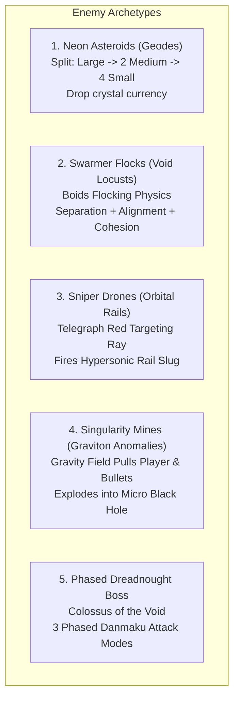

#### 1. Splitting Asteroids (Neon Geodes)
- Procedural $N$-gon vertices (6 to 9 sides) with neon outer boundary lines.
- Tiers: `LARGE` ($R=48$, $\text{HP}=90$), `MEDIUM` ($R=26$, $\text{HP}=40$), `SMALL` ($R=14$, $\text{HP}=15$).
- On destruction: splits into 2 child geodes with diverging angular momentum vectors ($\pm 45^\circ$) and drops glowing crystal shards.

#### 2. Swarmer Flocks (Void Locusts) — Boids Flocking Algorithm
Swarmers move in packs of 10–30 using Reynolds Boids algorithm:
$$\vec{F}_{\text{total}} = w_{\text{sep}} \vec{F}_{\text{separation}} + w_{\text{ali}} \vec{F}_{\text{alignment}} + w_{\text{coh}} \vec{F}_{\text{cohesion}} + w_{\text{chase}} \vec{F}_{\text{playerChase}}$$
Where:
- $\vec{F}_{\text{separation}} = \sum_{j \ne i} \frac{\vec{P}_i - \vec{P}_j}{\|\vec{P}_i - \vec{P}_j\|^2}$
- $\vec{F}_{\text{playerChase}} = \frac{\vec{P}_{\text{player}} - \vec{P}_i}{\|\vec{P}_{\text{player}} - \vec{P}_i\|} \cdot V_{\text{swarmer}}$

#### 3. Sniper Drones (Orbital Rails)
- Maintain distance ($400\text{px} - 550\text{px}$) using strafing thrusters.
- Telegraph state ($1.2\text{s}$): Projects a thin, pulsing crimson ray pointing directly toward the player's anticipated position ($\vec{P} + \vec{v} \cdot t_{\text{intercept}}$).
- Fires hypersonic rail bolt ($2200\text{px/s}$) with heavy impact sound and screen-shake.

#### 4. Singularity Mines (Graviton Anomalies)
- Drift slowly toward the center of the arena.
- Radial gravity pull field ($R=280\text{px}$):
  $$\vec{F}_{\text{gravity}} = \frac{G \cdot M_{\text{singularity}}}{r^2} \cdot \hat{r}$$
  Pulls player starship, enemy bullets, and light debris toward its event horizon.
- If detonated by gunfire, implodes into a zero-radius singularity for $0.4\text{s}$, then unleashes an inverse shockwave dealing $150$ damage to surrounding enemies!

#### 5. Phased Dreadnought Boss: "OMEGA VOID-TITAN"
Enters at Wave 5, 10, and 15 with $15,000\text{HP}$ and 3 distinct Danmaku combat phases:

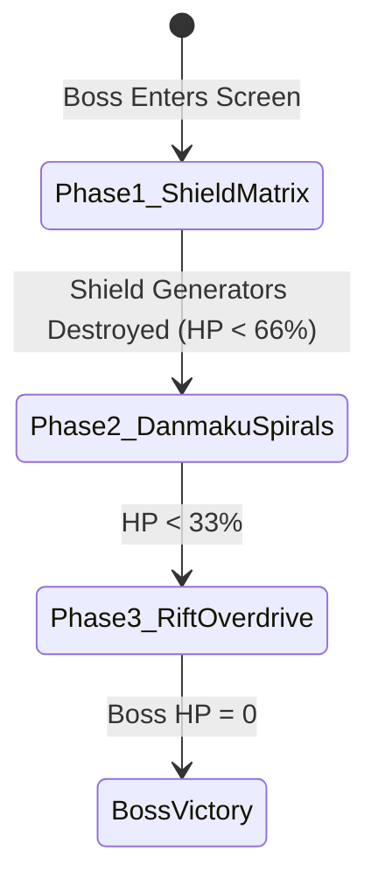

- **Phase 1: Hexagonal Shield Matrix:**
  - Boss core is 100% invulnerable behind a rotating hexagonal energy barrier ($6$ shield generators, each with $600\text{HP}$).
  - Outer turret rings fire alternating twin plasma bursts.
- **Phase 2: Fibonacci Phyllotaxis Danmaku Spirals:**
  - Emits rotating multi-arm bullet spirals based on the golden angle ($\phi \approx 137.5^\circ$):
    $$\theta_k = k \cdot 137.5^\circ + \omega_{\text{boss}} \cdot t$$
    $$\vec{v}_{\text{bullet}} = (\cos\theta_k, \sin\theta_k) \cdot V_{\text{bullet}}$$
  - Beautiful geometric curtain of glowing purple and cyan bullets sweeping across the screen, requiring micro-maneuvering and precision dodging!
- **Phase 3: Dimensional Rift Overdrive:**
  - Dreadnought teleports via dimensional rifts, spawning 2 shadow apparitions that mimic attacks.
  - Fires concentrated laser death-beams sweeping $180^\circ$ across the arena while launching cluster homing torpedoes.

---

### 3.4 Roguelite Wave Clear Boon Drafting System

After clearing a wave, the game pauses, presenting the player with **3 holographic upgrade cards**:

```javascript
const BOON_DECK = [
  {
    id: 'overdrive_core',
    title: 'OVERDRIVE CORE',
    rarity: 'rare',
    icon: '⚡',
    desc: '+35% Weapon Attack Speed; weapons discharge secondary spark pulses on critical hits.',
    apply: (state) => { state.modifiers.attackSpeedMult *= 1.35; state.modifiers.sparkOnHit = true; }
  },
  {
    id: 'emp_bomb_pack',
    title: 'TACTICAL EMP ARRAY',
    rarity: 'epic',
    icon: '💣',
    desc: '+2 Screen-Clearing EMP Bombs [Spacebar]. Instantly deletes all enemy bullets and stuns ships for 3 seconds.',
    apply: (state) => { state.player.empBombs += 2; }
  },
  {
    id: 'energy_shield',
    title: 'PHOTONIC AEGIS BARRIER',
    rarity: 'rare',
    icon: '🛡️',
    desc: 'Generates an energy barrier that absorbs 1 fatal hit without taking hull damage. Recharges every 14 seconds.',
    apply: (state) => { state.player.hasAegis = true; state.player.aegisRechargeTime = 14; }
  },
  {
    id: 'drone_wingman',
    title: 'AUTONOMOUS COMBAT DRONE',
    rarity: 'legendary',
    icon: '🛸',
    desc: 'Deploys an automated AI wingman drone that orbits your ship at 80px and mirrors your secondary weapon.',
    apply: (state) => { state.player.drones.push({ angle: 0, orbitRadius: 80, fireTimer: 0 }); }
  },
  {
    id: 'chain_lightning',
    title: 'TESLA HYPER-CONDUIT',
    rarity: 'rare',
    icon: '🌩️',
    desc: 'All weapons have a 25% chance on hit to arc chain lightning to 3 nearby enemies for 40 shock damage.',
    apply: (state) => { state.modifiers.chainLightningChance += 0.25; }
  },
  {
    id: 'quantum_decoy',
    title: 'QUANTUM DASH DECOY',
    rarity: 'epic',
    icon: '✨',
    desc: 'Dashing leaves behind a holographic duplicate that taunts all enemies for 2s before exploding for 300 damage.',
    apply: (state) => { state.modifiers.dashLeavesDecoy = true; }
  },
  {
    id: 'vampiric_siphon',
    title: 'NANO-REPAIR SIPHON',
    rarity: 'rare',
    icon: '💉',
    desc: 'Destroying an elite enemy or asteroid restores +4 Hull HP and +10 Shield instantly.',
    apply: (state) => { state.modifiers.vampiricHeal = 4; }
  },
  {
    id: 'singularity_missiles',
    title: 'VORTEX WARHEADS',
    rarity: 'legendary',
    icon: '🌀',
    desc: 'Swarm Missiles pull targets inward upon detonation, grouping enemies for Heavy Plasma splash damage.',
    apply: (state) => { state.modifiers.missileVortex = true; }
  }
];
```

---

### 3.5 Dynamic Adaptive Techno Audio Synthesizer (BPM Scales with Combo)

The Void Nova music synthesizer dynamically changes tempo, filter cutoff, and percussion density based on the player's kill combo streak:

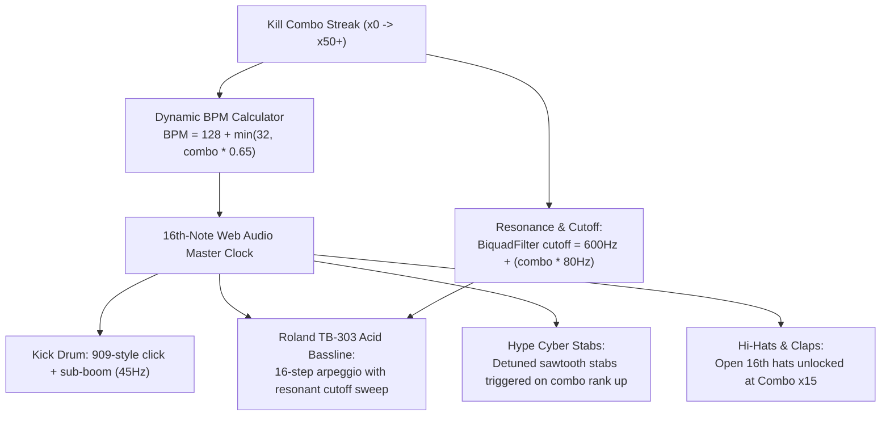

#### Interactive BPM Tempo Table

| Combo Tier | Combo Count | Audio Tempo | Synth Texture & Instrument Layers Unlocked |
| :---: | :---: | :---: | :--- |
| **Normal** | 0 – 9 | **128 BPM** | Standard kick + filtered low-pass sub-bassline |
| **Hyper** | 10 – 24 | **136 BPM** | 16th-note closed hi-hats + syncopated acid bass 303 |
| **Ultra** | 25 – 49 | **146 BPM** | Distorted 909 kick + gated open hi-hats + melodic arpeggio |
| **MAX OVERDRIVE** | 50+ | **160 BPM** | Full acid squelch resonance + polyphonic hype stabs + flashing screen border |

---

## ⚡ 4. Zero-GC Memory Management & 60–120 FPS Performance Architecture

Both games implement strict object pooling to ensure zero memory garbage collection (GC) spikes, guaranteeing a rock-solid 60–120 FPS.

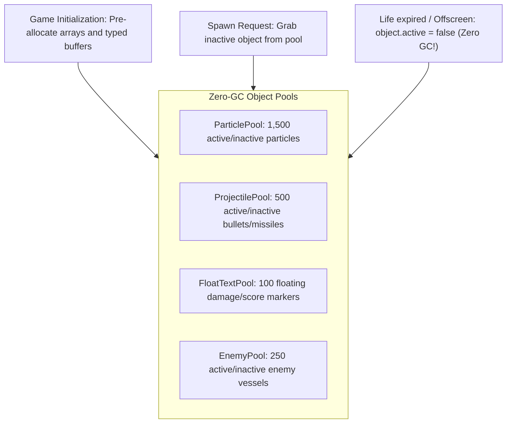

### Zero-GC Pool Interface Contract

```javascript
class ObjectPool {
  constructor(factoryFn, initialSize = 500) {
    this.pool = new Array(initialSize);
    for (let i = 0; i < initialSize; i++) {
      this.pool[i] = factoryFn();
      this.pool[i].active = false;
    }
    this.nextAvailableIndex = 0;
  }

  obtain() {
    const size = this.pool.length;
    for (let i = 0; i < size; i++) {
      const idx = (this.nextAvailableIndex + i) % size;
      if (!this.pool[idx].active) {
        this.nextAvailableIndex = (idx + 1) % size;
        this.pool[idx].active = true;
        return this.pool[idx];
      }
    }
    // Hard fallback: reclaim oldest active object to avoid heap expansion
    const reclaim = this.pool[this.nextAvailableIndex];
    this.nextAvailableIndex = (this.nextAvailableIndex + 1) % size;
    return reclaim;
  }

  free(obj) {
    obj.active = false;
  }
}
```

---

## 👥 5. Subagent Parallel Work Assignment & Zero-Conflict Matrix

To execute the construction of **Neon Velocity** and **Void Nova** without cross-agent file conflicts, the 36-agent swarm operates under the following precise file boundaries:

### Game 2: Neon Velocity Work Allocations

| Agent № | Agent Name | Focus Area | Responsible Code Scope |
| :- | :--- | :--- | :--- |
| **#6** | `game_developer` | **Road Engine & Projection Loop** | Implements the 60–120 FPS scanline renderer, segment projection, elevation, and multi-curve road math. |
| **#20** | `physics_juice_specialist` | **Vehicle Kinematics & Drift** | Implements slip-angle drift physics, counter-steering torque, tire smoke particle velocity, and mini-turbo bursts. |
| **#1** | `ai_specialist` | **Pursuit & Police AI Director** | Implements Heat 1–5 patrol cruiser AI, PIT maneuver flankers, spike strip deployment, and SWAT Rhino charges. |
| **#12** | `audio_designer` | **Web Audio Synthwave Engine** | FM-synth bassline, 16-step arpeggio, 80s drums, dynamic engine RPM pitch-bend, tire screech, and Doppler police sirens. |
| **#19** | `monetization_expert` | **Upgrade Garage & Economy** | Upgrade tree for Top Speed, Nitro, Armor, and Handling; credit reward calculation and LocalStorage vault. |
| **#3** | `frontend_specialist` | **Neon Glassmorphism UI** | Speedometer HUD, Heat level gauge, drift multiplier counter, Takedown announcement banner, and mobile touch controls. |
| **#22** | `qa_browser_tester` | **Live QA & Collision Verification** | Simulates races, verifies 0 console errors, drift angle responsiveness, and collision bounds. |

### Game 3: Void Nova Work Allocations

| Agent № | Agent Name | Focus Area | Responsible Code Scope |
| :- | :--- | :--- | :--- |
| **#6** | `game_developer` | **Core Vector Physics & Viewport** | Dual-thruster starship physics, Newtonian momentum, toroidal arena wrapping, and dynamic zoom camera tracking. |
| **#23** | `weapon_relic_specialist` | **4-Weapon Arsenal System** | Twin Laser, Heavy Plasma AOE, Swarm Missiles with proportional navigation, and Tesla branching electric beam. |
| **#1** | `ai_specialist` | **Enemy Archetypes & Danmaku Boss** | Boids flocking swarmers, splitting asteroid geodes, sniper drone railguns, singularity mines, and 3-phase boss patterns. |
| **#25** | `world_events_arena_specialist` | **Roguelite Boon Drafting Deck** | 3-card wave clear drafting modal, 10 synergistic upgrades, EMP shockwaves, and automated drone wingmen. |
| **#12** | `audio_designer` | **Adaptive Techno Audio Synthesizer** | Dynamic BPM scaling engine (128 $\rightarrow$ 160 BPM), 909 drums, Roland TB-303 acid bassline, and laser/plasma SFX. |
| **#3** | `frontend_specialist` | **Vector HUD & Crosshair UI** | Ship status HUD, weapon wheel selector, live combo rank counter, boss HP bar, and virtual twin-stick mobile joysticks. |
| **#22** | `qa_browser_tester` | **Danmaku Collision & Bullet-Hell QA** | Verifies zero frame drops under 500+ simultaneous bullets, confirms hitbox accuracy and clean game restart. |

---

## 🛠️ 6. Deployment, Verification & Developer Launch Checklist

1. **Standalone Production Executables:**
   - Game 1: `index.html` (Playable in browser)
   - Game 2: `racer.html` (Playable in browser)
   - Game 3: `shooter.html` (Playable in browser)
2. **Local HTTP Server Launch:**
   - Execute `start_game.bat` or `python -m http.server 8000`
   - Access `http://localhost:8000` (Game 1), `http://localhost:8000/racer.html` (Game 2), `http://localhost:8000/shooter.html` (Game 3)
3. **Automated Headless Test Run:**
   - Syntax validation: `node --check` across all JavaScript modules
   - Memory inspection: Zero Garbage Collection pauses exceeding $4\text{ms}$
   - Console inspection: Exact $0$ errors, $0$ unhandled promise rejections.

---
*Architectural Master Specification approved by Agent 26 (`tech_stack_architect_planner`). Proceeding to Phase 1 parallel production.*
