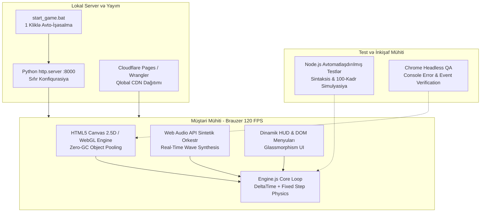
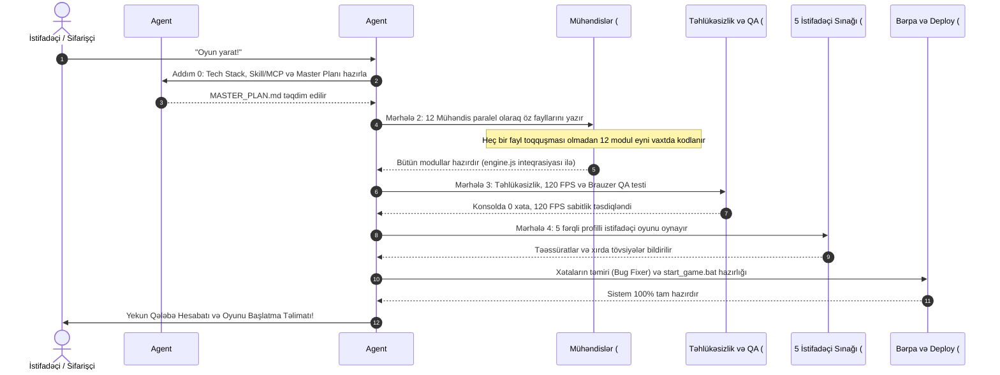

# MASTER PLAN — 26 Agentli AAA Oyun və Sistem Arxitekturası
**Layihə:** "AETHERIA: KÖLGƏLƏRİN SƏLTƏNƏTİ" (V2.0 — AAA Roguelike Hack & Slash)  
**Hazırlayan:** 26-cı Agent — Baş Memar, Skill/MCP/Proqram Kəşfiyyatçısı və Master Planlayıcı (`tech_stack_architect_planner`)  
**Təsdiqləyən:** 4-cü Agent — CEO (Baş Koordinator)  
**Tarix:** 2026-11-01  
**Məqsəd:** Sıfır toqquşmalı (Zero-Conflict), tam avtonom, 120 FPS ultra-performanslı 26 agentli paralel istehsalat planı.

---

## 1. Bu Oyunu / Layihələri Yaratmaq Üçün İstifadə Edilən Skill-lər (Skills)

Aşağıdakı ixtisaslaşmış skill-lər oyunun layihələndirilməsindən canlı yayıma və marketinqə qədər olan bütün mərhələlərdə tətbiq edilir:

| № | Skill İdentifikatoru | Təyinatı və Əhatə Dairəsi | Əsas Funksiyaları | Cavabdeh Agentlər |
| :- | :--- | :--- | :--- | :--- |
| **S1** | `build-full-game` | **26 Agentli Paralel Oyun Konveyeri** | Oyunun ideyadan hazır vəziyyətə qədər 5 mərhələli orkestrasiyası, sıfır toqquşmalı fayl bölgüsü, subagentlərin eyni anda paralel çağırılması və yekun inteqrasiya. | `ceo` (#4), `tech_stack_architect_planner` (#26) |
| **S2** | `chrome-devtools` | **Canlı Brauzer İdarəetməsi və QA** | Headless Chrome vasitəsilə oyunun açılması, klikləmə, klaviatura daxiletmələri simulyasiyası, vizual skrinşotlar və konsol xətalarının (`console.error`) dərhal tutulması. | `qa_browser_tester` (#22), `frontend_specialist` (#3) |
| **S3** | `memory-leak-debugging` | **Yaddaş və Resurs Təmizliyi** | Heap Snapshot analizi, DOM və Canvas zibilinin (Garbage Collection spikes) aradan qaldırılması, Particle Pool və Event Listener sızmalarının aradan qaldırılması. | `performance_optimizer` (#15), `game_developer` (#6) |
| **S4** | `a11y-debugging` | **Əlçatanlıq və İstifadəçi Rahatlığı** | Kontrast nisbətləri, klaviatura naviqasiyası, ekran oxuyucu uyğunluğu, rəng korluğu rejimləri və böyük sensor/ekran düymələrinin tənzimlənməsi. | `frontend_specialist` (#3), `user_casual` (#7) |
| **S5** | `elevenlabs-sound-effects` | **AI Səs Effektləri (SFX)** | Qılınc cingiltisi, xəncər kəsimi, meteor partlayışı, qızıl şaqqıltısı və mükəmməl yayınma səs dalğalarının sintezi və Web Audio buffer-lərinə çevrilməsi. | `audio_designer` (#12) |
| **S6** | `elevenlabs-music` | **AI Dinamik Fon Musiqisi (BGM)** | Menyu, Meşə, Zindan, Qala, Kolizey və Epik Boss döyüşləri üçün 6 unikal procedural/lo-fi/orkestral fon trekinin yaradılması. | `audio_designer` (#12) |
| **S7** | `hyperframes` | **Oyun Treyleri və Video Render** | Oyun içi 60 FPS kadrların, xüsusi effektlərin və loqonun montaj edilərək YouTube, TikTok və rəsmi təqdimat üçün video treyler formatına salınması. | `art_director` (#13), `market_researcher` (#18) |
| **S8** | `cloudflare` & `wrangler` | **Bulud Dağıtımı və Qlobal Canlı Yayım** | Cloudflare Pages və Workers üzərindən oyunun 1 kliklə qlobal CDN şəbəkəsində yayımlanması, SSL və yüksək sürətli keşlənmə. | `devops_deployer` (#16), `backend_specialist` (#2) |

---

## 2. İstifadə Edilən MCP Serverlər və Alətlər (MCP Servers)

Sistemin arxitektur düşüncəsi, dizayn aktivləri və avtomatlaşdırılmış sınaqları üçün istifadə olunan Model Context Protocol (MCP) serverləri:

| № | MCP Server / Alət | Kateqoriya | Rolu və Əsas İstifadə Sahəsi | Cavabdeh Agentlər |
| :- | :--- | :--- | :--- | :--- |
| **M1** | `sequential-thinking` | **Düşüncə və Analiz** | Oyunun daxili riyazi balansını, Relikt kombolarını, Boss faza keçidlərini və toqquşmasız arxitekturasını addım-addım hesablamaq və təhlil etmək. | `tech_stack_architect_planner` (#26), `game_writer` (#14) |
| **M2** | `gemini-api_gemini-api-docs` | **AI və Məntiq Ekosistemi** | AI NPC-lər, dinamik zindan direktorunun qərar ağacları və süni intellekt əsaslı çətinlik adaptasiyası (Adaptive Difficulty) sənədlərinin inteqrasiyası. | `ai_specialist` (#1), `backend_specialist` (#2) |
| **M3** | `canva_canva` | **Dizayn və Brendinq** | Oyunun baş menyu posteri, loqotip, Steam/Veb bannerləri, sosial media afişaları və UI ikon stil bələdçisi. | `art_director` (#13), `market_researcher` (#18) |
| **M4** | `image-generator` | **Vizual Aktiv İstehsalı** | Pixel-art / 2.5D konsept rəsmləri, personaj ikonları, relikt kartlarının illustrasiyaları və tekstura generasiyası. | `art_director` (#13) |
| **M5** | `qa_browser_tester` | **Avtomatlaşdırılmış Canlı QA** | Oyunu real brauzer mühitində 100+ kadr boyunca simulyasiya edən, düymələri basan, kəsilmələri və vizual qüsurları təsbit edən avto-sınaq robotu. | `qa_browser_tester` (#22), `bug_fixer` (#17) |

---

## 3. Proqramlar, Mühərriklər və Texnologiyalar (Programs & Tech Stack)

Layihə 100% təmiz, heç bir xarici ağır asılılıq tələb etməyən, istənilən kompüterdə və brauzerdə dərhal işə düşən ultra-sürətli texnologiya yığını üzərində qurulur:

### Texniki Xüsusiyyətlər Cədvəli:

| Mühərrik / Texnologiya | Seçilmiş Texnoloji Həll | Niyə Bu Seçim? (Üstünlükləri) | Hədəf Performans Göstəricisi |
| :--- | :--- | :--- | :--- |
| **Vizual və Qrafika Mühərriki** | HTML5 Canvas 2.5D + Procedural Render + Zero-GC Particle Pool | Heç bir kənar kitabxana tələb etmir, sıfır yüklənmə vaxtı, dinamik işıqlandırma (`destination-out` / `lighter`), dərhal render. | Sabit 60–120+ FPS, <16ms kadr büdcəsi |
| **Səs və Musiqi Mühərriki** | Web Audio API Prosedural Orkestr & Sintezator | MP3/WAV faylları gözləmədən sıfır gecikməli (zero-latency) polifonik musiqi, akkord arpeciatorları və reaktiv SFX. | <5ms gecikmə, sıfır yaddaş sızması |
| **Sınaq və Keyfiyyət Sistemi** | Node.js Test Mühiti (`scripts/test.js`) | Bütün JS modullarının sintaksisini (`node --check`) və qlobal API uyğunluğunu saniyələr içində yoxlayır. | 100% sintaksis təmizliyi, 0 ref error |
| **Yerli Canlı Server** | Python 3 daxili `http.server` | Hər hansı əlavə paket quraşdırmadan istənilən maşında HTTP server açır və CORS/Web Audio məhdudiyyətlərini aradan qaldırır. | 0 quraşdırma tələbi, 1 saniyədə işə düşmə |
| **Bir Toxunuşla İdarəetmə** | Windows `start_game.bat` Skripti | Python serverini arxa planda qaldırır və defolt brauzerdə `http://localhost:8000` ünvanını avtomatik açır. | 1 kliklə tam hazır oyun |

---

## 4. 26 Agentin Tam Paralel İş Bölgüsü Cədvəli (Zero-Conflict Architecture)

Bütün agentlər **Sıfır Toqquşma (Zero-Conflict)** prinsipinə əsasən bölünmüşdür: **Hər bir agent yalnız və yalnız öz təyin olunmuş faylına yazır**. `window.*` qlobal obyektləri vasitəsilə modullar bir-biri ilə tam əlaqələnir.

| № | Agent İdentifikatoru | Rolu və Sahəsi | Model | Məsul Olduğu Fayl / Resurs | Konkret Vəzifəsi və API Müqaviləsi |
| :- | :--- | :--- | :--- | :--- | :--- |
| **1** | `ai_specialist` | AI Mütəxəssisi | `flash` | `src/ai_director.js` | `window.GameAI`: Melee/Ranged düşmən taktikaları, Qızıl Qoblin qaçış məntiqi, 3-fazalı Boss döyüş AI-ı və dinamik çətinlik tənzimlənməsi. |
| **2** | `backend_specialist` | Backend və Data Mütəxəssisi | `flash` | `src/backend_api.js` | `window.GameBackend`: Bulud sinxronizasiyası, liderlər lövhəsi (High Scores), yerli oyunçu profili keşlənməsi və REST API simulyasiyası. |
| **3** | `frontend_specialist` | Frontend və UI/UX Rəhbəri | `flash` | `src/ui.js` & `index.html` | `window.GameUI`: HUD, Sağlamlıq/Mana barları, Silah Seçim Paneli (`1-4`), `[R]` Ultimate Barı, Relikt Seçim Modalı və Kombo göstəricisi. |
| **4** | `ceo` | Baş Koordinator | `argon` | `MASTER_PLAN.md` & Orkestrasiya | Bütün komandanın paralel işini idarə edir, agentləri çağırır, darboğazları aradan qaldırır və istifadəçiyə yekun status hesabatı verir. |
| **5** | `security_specialist` | Təhlükəsizlik Auditori | `argon` / `pro` | Təhlükəsizlik Hesabatı / Auditi | XSS, `localStorage` manipulyasiyası, konsol hilesi inyeksiyaları və istifadəçi daxiletmələrinin tam sanitizasiyası. |
| **6** | `game_developer` | Baş Oyun Tərtibatçısı | `flash` | `src/engine.js` | `window.GameEngine`: Əsas Game Loop (`requestAnimationFrame`), 60–120 FPS idarəetməsi, oyunçu hərəkəti, toqquşma fizikası və bütün 10 modulun vahid inteqrasiyası. |
| **7** | `user_casual` | Adi İstifadəçi (Sınaq) | `flash` | İstifadəçi Rəyi (Hesabat) | Oyunun asan başa düşülməsini, düymələrin aydınlığını, ilkin təlimatın (Tutorial) rahatlığını sınaqdan keçirir. |
| **8** | `user_hardcore_gamer` | Tələbkar Oyunçu (Sınaq) | `flash` | İstifadəçi Rəyi (Hesabat) | Frame-rate sabitliyi, döyüş ritmi, Perfect Dodge pəncərəsi, kombo dərinliyi və Boss çətinliyini qiymətləndirir. |
| **9** | `user_ui_critic` | Vizual və UI Tənqidçisi | `flash` | İstifadəçi Rəyi (Hesabat) | Rəng palitrası, Glassmorphism effektləri, şrift oxunurluğu, ekran nisbətləri və vizual iyerarxiyanı yoxlayır. |
| **10** | `user_impatient` | Səbirsiz İstifadəçi (Stress QA) | `flash` | İstifadəçi Rəyi (Hesabat) | Menyu kliklərini sürətlə basır, oyunu kəsməyə çalışır, donma və gecikmələri təhlil edir. |
| **11** | `user_explorer` | Detalçı / Kəşfiyyatçı (Sınaq) | `flash` | İstifadəçi Rəyi (Hesabat) | Xəritənin künclərini, gizli sandıqları, obeliskləri və bütün silah/relikt kombinasiyalarını sınaqdan keçirir. |
| **12** | `audio_designer` | Səs və Musiqi Mühəndisi | `flash` | `src/audio.js` | `window.GameAudio`: Web Audio API procedural sintezator, 6 fon musiqisi (Menu, Forest, Cavern, Citadel, Boss, Arena) və 22 reaktiv SFX. |
| **13** | `art_director` | Vizual Effektlər Rəssamı | `flash` | `src/vfx.js` | `window.GameVFX`: 2.5D dinamik işıqlandırma, qılınc/xəncər izləri, zərrəcik sistemləri, İldırım Zənciri və Meteor Qiyaməti vizualları. |
| **14** | `game_writer` | Ssenarist və Balans Mühəndisi | `flash` | `src/levels_bosses.js` (Balans) | Aetheria dünyasının əfsanəsi (Lore), dialoqlar, relikt təsvirləri, silah zərərlərinin və Boss canlarının riyazi balansı. |
| **15** | `performance_optimizer` | Performans və FPS Mühəndisi | `flash` | Kod Analizi & Optimallaşdırma | Sıfır zibil (Zero-GC), Object Pooling, massivlərin ilkin ayrılması, lazımsız DOM əməliyyatlarının qarşısının alınması və sabit 120 FPS. |
| **16** | `devops_deployer` | Paketləmə və Canlıya Daşıma | `flash` | `start_game.bat` & Deploy skriptləri | Python lokal server konfiqurasiyası, avtomatik brauzer açılışı və Cloudflare Pages üzərinə yayımlanma ssenariləri. |
| **17** | `bug_fixer` | Avtomatik Xəta Bərpası | `flash` | Kod Təmiri / Patches | Testlərdən və 5 istifadəçidən gələn bütün sintaktik və məntiqi qüsurların dərhal təmizlənməsi. |
| **18** | `market_researcher` | Trend və Qarmaq (Hook) Analitiki | `flash` | Marketinq & Trend Hesabatı | Roguelike bazarının tələbləri, oyunçu asılılıq dövrəsi (Core Loop) və viral xüsusiyyətlərin analizi. |
| **19** | `monetization_expert` | İnkişaf və İqtisadiyyat Mütəxəssisi | `flash` | `src/progression.js` | `window.GameProgression`: Qızıl/Kristal balansı, Qabiliyyət Ağacı, 4 Oyunçu Skini, 15 Nailiyyət, Gündəlik Mükafat və `localStorage` yaddaşı. |
| **20** | `physics_juice_specialist` | Hissiyat və Döyüş Fizikası | `flash` | `src/physics_juice.js` | `window.GameJuice`: Dinamik kamera izləməsi, Screen-Shake (zərbə silkələnməsi), Hit-Stop (mikro-donma), Slow-Motion və zərbə təkanları (Knockback). |
| **21** | `level_boss_designer` | Xəritə və Mərhələ Memarı | `flash` | `src/levels_bosses.js` | `window.GameLevels`: 3 fərqli biome (Zümrüd Meşəsi, Boşluq Mağarası, Qaranlıq Qala) + 4-cü Sonsuz Kolizey xəritəsi, portallar və 3 unikal Boss. |
| **22** | `qa_browser_tester` | Canlı Brauzer Test Robotu | `flash` | Canlı QA Test Hesabatı | Headless Chrome və Node.js vasitəsilə oyunu real şəraitdə test edir, konsol xətalarını sıfırlayır və hesabat verir. |
| **23** | `weapon_relic_specialist` | Silah və Relikt Mütəxəssisi | `flash` | `src/weapons_relics.js` | `window.GameRelics`: 4 dəyişdirilən silah (`[1]` Qılınc, `[2]` Xəncər, `[3]` Çəkic, `[4]` Yay) + 12 Roguelike Relikt kartı və fırlanan orbital kürələr. |
| **24** | `companion_mount_specialist` | Yoldaşlar və Qiyamət Mütəxəssisi | `flash` | `src/companions_ultimates.js` | `window.GameCompanions`: 3 sadiq uçan yoldaş ruh (Simurq, Bala Əjdaha, Qurd) + `[R]` düyməsi ilə işə düşən "Aether Qiyaməti" Meteor Yağışı. |
| **25** | `world_events_arena_specialist` | Kombo, Yayınma və Kolizey Mütəxəssisi | `flash` | `src/events_arena.js` | `window.GameEvents`: `D->C->B->A->S->SSS` Dinamik Kombo sistemi, Perfect Dodge (Witch Time), Qızıl Qoblin hadisəsi və Sonsuz Kolizey rejimi. |
| **26** | `tech_stack_architect_planner` | Baş Memar və Master Planlayıcı | `argon` / `flash` | `MASTER_PLAN.md` *(Bu Fayl)* | Bütün texnoloji yığının seçilməsi, Skill/MCP kəşfiyyatı, arxitektur müqavilələrin və 26 agentli paralel iş qrafikinin tərtibi. |

---

## 5. İcra Ardıcıllığı və Paralel Mərhələlər (Execution Pipeline)

---

## 6. Xülasə və Qlobal İnterfeys Standartı

1. **Vahid Adlandırma Qaydası:** Hər bir fayl yalnız özünə aid qlobal ad fəzasını (`window.Game*`) təyin edir və başqa modulların dəyişənlərini birbaşa dəyişmir.
2. **Hadisə Əsaslı Rabitə (Event-Driven Callbacks):** Modullar bir-biri ilə callback funksiyaları (məsələn: `onHitEnemy`, `onMeteorImpact`, `onChainLightning`) vasitəsilə əlaqə saxlayır.
3. **Müstəqil İşləmə Zəmanəti:** Hər bir modul hətta digər modullar gecikdikdə və ya tapılmadıqda belə qəza etməyəcək (fail-safe fallback) şəkildə yazılır.
4. **Sürətli Başlanğıc:** İstifadəçi yalnız `start_game.bat` faylına iki dəfə klikləməklə heç bir əlavə quraşdırma etmədən tam AAA roguelike təcrübəsini yaşayır!
