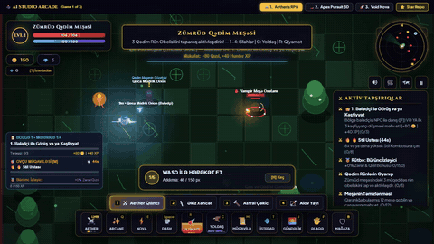
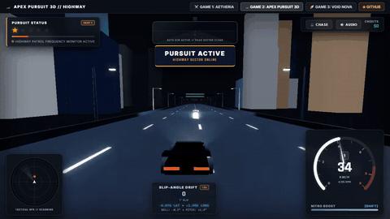
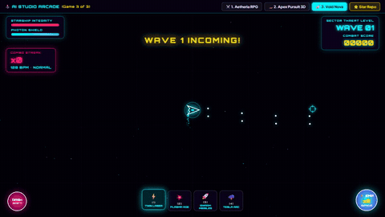
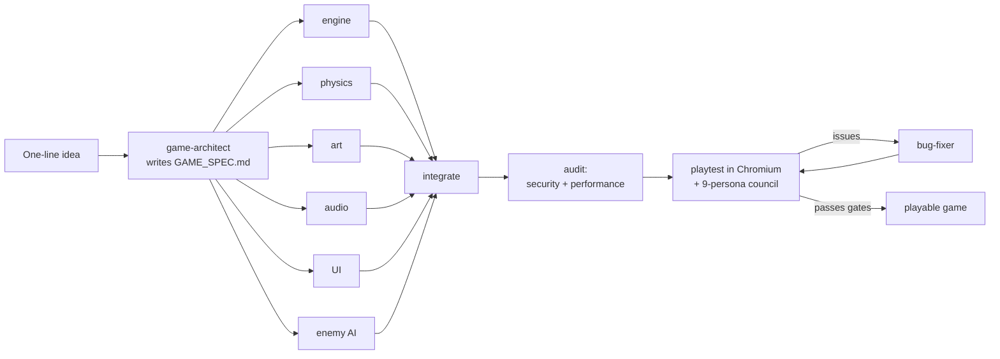

<div align="center">


# Game Studio for AI coding agents

**Describe a game in one sentence. A team of 28 specialist subagents designs it, builds it in parallel, plays it in a real browser, and fixes what breaks.**

[](https://github.com/Muzaqil555/game-for-ai/actions/workflows/playtest.yml)
[](docs/INSTALL.md)
[](AGENTS.md)
[](docs/INSTALL.md)
[](LICENSE)

<table>
<tr>
<td align="center"><a href="https://muzaqil555.github.io/game-for-ai/"></a><br/><b>Aetheria</b><br/><sub>roguelite action RPG</sub></td>
<td align="center"><a href="https://muzaqil555.github.io/game-for-ai/racer.html"></a><br/><b>Apex Pursuit 3D</b><br/><sub>Three.js police-chase racer</sub></td>
<td align="center"><a href="https://muzaqil555.github.io/game-for-ai/shooter.html"></a><br/><b>Void Nova</b><br/><sub>twin-stick bullet hell</sub></td>
</tr>
</table>

<sub>All three are built by the studio with zero image or audio files: graphics are procedural Canvas/Three.js, sound is synthesised with Web Audio. Click a GIF to play in your browser.</sub>

</div>

---

## Install

In Claude Code:

```
/plugin install game-studio --marketplace Muzaqil555/game-for-ai
```

Then, in the project where you want to make games:

```
/game-studio:studio-init
/game-studio:new-game a neon roguelite where you slice drones with a laser katana
```

Older Claude Code, Codex, Cursor, Antigravity, or cloning this repo as a template: see [docs/INSTALL.md](docs/INSTALL.md).

---

## What happens when you run `/new-game`



1. **One owner per file.** `game-architect` writes `GAME_SPEC.md`: every file has exactly one owner, and every module's API is defined before code exists. Builders then work in parallel without overwriting each other.
2. **Only the agents the game needs.** A small arcade game uses 6–8 agents, not 28. Each subagent costs a full context, so the CEO (your main session) picks from the roster.
3. **Gates, not vibes.** A phase finishes when its check passes, not when an agent says it is done: `npm run check`, then `npm run playtest` with 0 console errors and ≥ 55 FPS on a real GPU, then a council score of 7/10 or more.
4. **Real playtesting.** `tools/playtest.mjs` opens the game in Chromium on your GPU, finds and clicks the start button, mashes keys and the mouse for 20 seconds, and records errors, failed requests, FPS and screenshots. The council and QA agents read that evidence, screenshots included.

---

## Commands

| Command | What it does |
| :- | :- |
| `/new-game <idea>` | The full pipeline: spec, parallel build, audit, playtest, fix loop, then delivery with FPS and council score |
| `/playtest <page>` | QA run on desktop and mobile, then a 9-persona verdict with the top 5 fixes ranked |
| `/add-feature <page> <feature>` | Adds a system to an existing game as a new module and checks FPS before and after |
| `/studio-init` | Sets up any project: copies `AGENTS.md` and the playtest tools, adds npm scripts, installs Playwright |

As a plugin, the commands are prefixed: `/game-studio:new-game`.

---

## The team

28 subagents, each with a workflow, a quality bar, things it must never do, and a standard report. The full roster is in [AGENTS.md](AGENTS.md).

| Group | Agents | Model |
| :- | :- | :- |
| **Plan** | `game-architect` · `genre-researcher` · `skill-scout` | opus · haiku · sonnet |
| **Core build** | `game-engine-developer` · `physics-game-feel-engineer` · `art-director` · `audio-designer` · `ui-hud-engineer` · `enemy-ai-engineer` · `backend-persistence-engineer` | sonnet |
| **Content & systems** | `narrative-balance-designer` · `level-boss-designer` · `weapons-upgrades-designer` · `companion-ultimate-designer` · `combo-events-designer` · `mission-campaign-designer` · `loot-synergy-designer` · `elite-enemy-designer` · `meta-progression-designer` · `progression-economy-designer` · `onboarding-designer` | sonnet |
| **Quality** | `security-auditor` · `performance-optimizer` · `qa-browser-tester` · `bug-fixer` · `engagement-psychologist` · `devops-deployer` | opus · sonnet · haiku |
| **Playtest council** | `playtest-council`: casual newcomer, hardcore gamer, UI critic, impatient stress tester, explorer, story fan, streamer, completionist, teen action gamer | haiku |

`opus`, `sonnet` and `haiku` are aliases, so the agents always use the newest model of each tier.

---

## The demo games, measured

Numbers from `npm run playtest -- <page> --seconds 20` on an RTX 4050 laptop: real GPU, 20 seconds of random input.

| Game | Average FPS | 95th-percentile frame | Console errors | Play |
| :- | :- | :- | :- | :- |
| Aetheria (`index.html`) | 111 (median of 8 runs) | 14 ms | 0 | [play](https://muzaqil555.github.io/game-for-ai/) |
| Apex Pursuit 3D (`racer.html`) | 118 | 13.9 ms | 0 | [play](https://muzaqil555.github.io/game-for-ai/racer.html) |
| Void Nova (`shooter.html`) | 142 | 7.1 ms | 0 | [play](https://muzaqil555.github.io/game-for-ai/shooter.html) |

Aetheria ran at 40–79 FPS until the studio's own `performance-optimizer` profiled it. It found that emoji text in the weapon-switch popups was being re-rasterised every frame, and caching it took the game past 100 FPS. The before/after measurements are in [reports/audit-performance.md](reports/audit-performance.md).

CI runs the same playtest on every push, using software rendering because runners have no GPU (see the badge above).

---

## Try a prompt

```
/new-game Build an ultra-performant Vampire Survivors-style horde game: 5,000 swarming enemies at 60 FPS using spatial-grid pooling, auto-firing orbiting plasma blades, XP gem magnetism, level-up cards with weapon evolutions, a 15-minute clock and miniboss waves.
```

```
/new-game Create a precision platformer mixing Celeste movement with Geometry Dash rhythm: 8-frame coyote time, 6-frame jump buffer, wall jumps, an instant gravity-flip button, 6 zones of neon hazards and instant respawn.
```

Six more recipes, with Azerbaijani versions, are in [PROMPTS.md](PROMPTS.md). Prompts work in any language.

---

## What's in the repo

```
.claude/agents/        28 subagents (Claude Code format; any agent can read them as Markdown)
.claude/commands/      /new-game, /playtest, /add-feature, /studio-init
.claude-plugin/        plugin manifest (game-studio) and marketplace (game-for-ai)
.agents/skills/        engine skills: universal-game-engine, threejs-webgl-game-engine,
                       game-plugin-module, build-full-game
AGENTS.md              roster, pipeline, gates, studio rules, report format
tools/playtest.mjs     automated Chromium playtest: errors, FPS, screenshots
tools/check.mjs        syntax checks and agent-definition validation
index.html racer.html shooter.html src/   the three demo games
docs/INSTALL.md        every way to install; docs/az/ holds the Azerbaijani originals
```

---

## Contributing

New agents, genre skills, and games built with the studio are all welcome.

- **A new agent:** add `.claude/agents/<name>.md`, list it in the `AGENTS.md` roster and in `.claude-plugin/plugin.json`, then run `npm run check` (it fails if one of the three is missing).
- **A game made with the studio:** open an issue with a link and the prompt you used. Good ones get featured here.
- **Before a PR:** `npm run check` and `npm run playtest -- <page>` for any game you touched.

## License

MIT. See [LICENSE](LICENSE).

<div align="center">

If the studio built something fun for you, a ⭐ helps other people find it.

</div>
